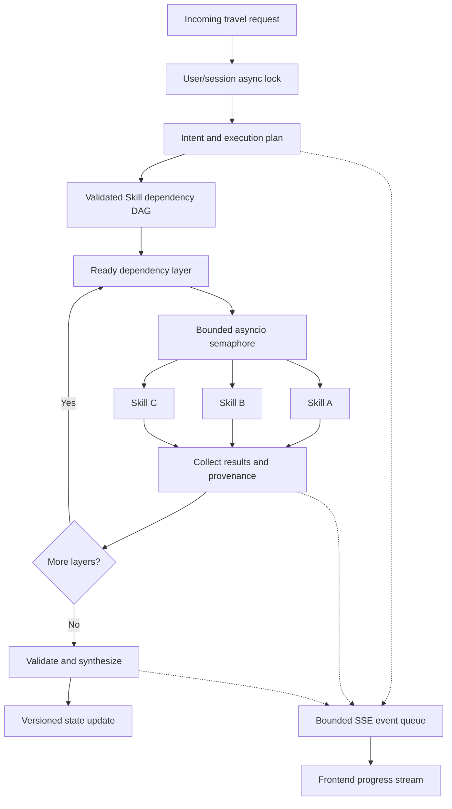
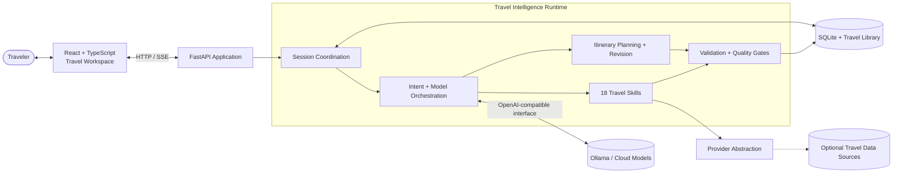
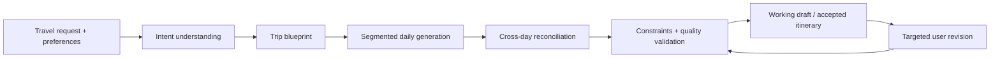

<a id="top"></a>

<div align="center">

<picture>
  <source media="(prefers-color-scheme: dark)" srcset="web/public/brand/poreiago-wordmark-dark.png">
  <source media="(prefers-color-scheme: light)" srcset="web/public/brand/poreiago-wordmark-light.png">
  
</picture>

### Your journey starts here.

**An intelligent travel workspace built for planning, adapting, and exploring.**

From an open-ended idea to a structured itinerary: PoreiaGo combines language-model reasoning, specialized travel Skills, live-capable data adapters, and persistent trip state in one extensible platform.

<p>
  
  
  
  
  
</p>

[**Explore Features**](#-experience) · [**Engineering Highlights**](#-engineering-highlights) · [**Architecture**](#-system-architecture) · [**Travel Skills**](#-18-specialized-travel-skills) · [**Quick Start**](#-quick-start) · [**Testing**](#-testing--quality)

</div>

---

## ✨ Experience

PoreiaGo is more than a chat interface. It is a stateful travel-planning workspace in which **conversation, planning constraints, itinerary versions, tools, and retrieved evidence** work together.

<table>
  <tr>
    <td width="33%" valign="top">
      <h3>🧭 Conversational planning</h3>
      Turn destination ideas, dates, interests, and constraints into organized 1–30-day itineraries through natural-language requests.
    </td>
    <td width="33%" valign="top">
      <h3>🔁 Context-preserving revisions</h3>
      Modify a day or individual activity, protect established requirements, and keep the rest of the trip intact when possible.
    </td>
    <td width="33%" valign="top">
      <h3>🧩 Specialized travel Skills</h3>
      Use 18 manifest-defined capabilities for discovery, logistics, weather, schedule checks, and adaptive replanning.
    </td>
  </tr>
  <tr>
    <td width="33%" valign="top">
      <h3>🎯 Persistent preferences</h3>
      Reuse preferences for pace, budget, transportation, dining, accommodation, interests, accessibility, and atmosphere.
    </td>
    <td width="33%" valign="top">
      <h3>📚 Travel knowledge library</h3>
      Store reference material and retrieve it with lexical search or optional semantic search and reranking.
    </td>
    <td width="33%" valign="top">
      <h3>🧠 Configurable models</h3>
      Choose local Ollama models or configured cloud endpoints, and assign model profiles to distinct planning stages.
    </td>
  </tr>
</table>

> [!NOTE]
> PoreiaGo is under active development. External data availability, travel recommendations, language quality, and inference speed depend on the selected models, provider access, network conditions, and local hardware. An itinerary is not a confirmed reservation.

## ⚡ Engineering highlights

<table>
  <tr>
    <td width="50%" valign="top">
      <h3>⚙️ Async-first execution</h3>
      FastAPI and <code>asyncio</code> coordinate nonblocking I/O, concurrent independent Skill calls, deadline management, and asynchronous model workflows.
    </td>
    <td width="50%" valign="top">
      <h3>🔀 Dependency-aware orchestration</h3>
      Skills run in validated dependency layers. Independent tasks execute together; downstream tasks receive only completed, declared upstream evidence.
    </td>
  </tr>
  <tr>
    <td valign="top">
      <h3>📡 Real-time SSE with backpressure</h3>
      Stream progress and results through Server-Sent Events. A bounded <code>asyncio.Queue</code> slows producers when consumers fall behind instead of silently dropping events.
    </td>
    <td valign="top">
      <h3>🛡️ Concurrency-safe session state</h3>
      Per-user, per-session async locks serialize overlapping reads, generations, and writes. Version checks protect itinerary updates from stale revisions.
    </td>
  </tr>
  <tr>
    <td valign="top">
      <h3>🧠 Multi-stage model orchestration</h3>
      Separate routing, reasoning, blueprint, daily generation, repair, and synthesis roles. Generate detailed days with controlled parallelism and stage-specific budgets.
    </td>
    <td valign="top">
      <h3>✅ Reliability by design</h3>
      Apply schema validation, schedule checks, bounded retries and fallbacks, partial-failure reporting, and persistent version history before accepting travel-plan changes.
    </td>
  </tr>
</table>

### Bounded concurrency, not uncontrolled fan-out

PoreiaGo uses parallel execution where tasks are independent, with explicit limits to protect model capacity, external services, and shared state.

| Mechanism | Implementation | Default / boundary |
|:--|:--|:--|
| **Parallel Skill execution** | `asyncio.gather()` + `asyncio.Semaphore` within dependency layers | 4 concurrent Skills by default; configurable up to 12 |
| **Dependency ordering** | Validated Skill DAG; results from a completed layer feed later layers | No consumption of in-flight sibling results |
| **Model day generation** | Per-day generation inside coordinated planning segments | Sequential by default; optional parallelism of 2–3 |
| **Session serialization** | Async lock keyed by user and session | One active generation/write workflow per session |
| **SSE buffering** | Bounded producer/consumer queue | 64 events by default; configurable from 8 to 512 |
| **Streaming keepalive** | Periodic SSE heartbeat | 15 seconds by default |
| **Execution deadlines** | `asyncio.wait_for()` and overall execution timeout | Configurable per stage and request |
| **Recovery budget** | Manifest-declared fallback Skills; capped attempts | 2 recovery steps by default |

These are **concurrency-control features, not published throughput benchmarks**. No requests-per-second, user-capacity, or distributed-scaling claim is implied.

<details>
<summary><strong>Explore the async execution model</strong></summary>



The graph illustrates the orchestration pattern. Actual Skill dependencies, recovery permissions, and available providers are defined by the selected Skill manifests and execution plan.

</details>

## 🏗️ System architecture



| Layer | Responsibilities |
|:--|:--|
| **Application** · `app/` | FastAPI endpoints, streaming interfaces, administrative operations |
| **Core** · `core/` | Runtime coordination, typed contracts, security boundaries, Skill DAG execution |
| **Intelligence** · `intelligence/` | Model gateway, intent understanding, prompts, model roles, generation workflows |
| **Planning** · `planning/` | Segmented itinerary creation, revisions, reconciliation, schedule constraints |
| **Skills** · `plugins/skills/` | Manifest-driven travel tools with input schemas and declared dependencies |
| **Services** · `services/` | Provider adapters, Skill dispatch, integration boundaries |
| **Storage** · `storage/` | Scoped conversations, itineraries, drafts, preferences, knowledge retrieval |
| **Quality** · `quality/` | Content checks, integrity validation, diagnostic signals |
| **Evaluation** · `evaluation/` + `benchmarks/` | Executable evaluation tools and versioned benchmark datasets |

### Model-centric, structured travel generation



Rather than asking a model to produce an entire long trip in one unbounded response, the planner supports **blueprint-first, day-by-day generation**, structured outputs, targeted activity repair, and cross-day consistency checks. Model budgets and recovery paths are bounded to reduce runaway generation and unintended edits.

## 🧩 18 specialized travel Skills

The Skill Catalog consists of modular implementations discovered from manifests. Each Skill declares its identity, inputs, execution handler, provider requirements, and any dependencies or recovery rules.

<table>
  <tr>
    <th width="33%">🌍 Discovery & local context</th>
    <th width="33%">🗺️ Logistics & exploration</th>
    <th width="34%">🛡️ Planning & verification</th>
  </tr>
  <tr>
    <td valign="top">
      <ul>
        <li>Place Discovery</li>
        <li>Neighborhood Intelligence</li>
        <li>Day Trip Discovery</li>
        <li>Cultural Experience Search</li>
        <li>Culinary Specialty Discovery</li>
        <li>Seasonal Experience Intelligence</li>
      </ul>
    </td>
    <td valign="top">
      <ul>
        <li>Restaurant Discovery</li>
        <li>Local Events Discovery</li>
        <li>Multi-Stop Route Optimizer</li>
        <li>Opening Hours Intelligence</li>
        <li>Ticket Entry Planning</li>
        <li>Hourly Weather Forecast</li>
      </ul>
    </td>
    <td valign="top">
      <ul>
        <li>Itinerary Feasibility Audit</li>
        <li>Schedule Conflict Validation</li>
        <li>Disruption Replanning</li>
        <li>Accessibility Suitability</li>
        <li>Trip Budget Allocation</li>
        <li>Place Detail Verification</li>
      </ul>
    </td>
  </tr>
</table>

**Execution guarantees and boundaries**

- **Manifest-validated inputs** with JSON Schema and typed output contracts.
- **Dependency-aware bindings** that can read declared upstream structured data without evaluating arbitrary expressions.
- **Bounded parallel execution** for independent tasks and manifest-authorized fallback recovery.
- **Explicit outcomes** such as `ok`, `partial`, `unavailable`, and `error`, rather than invented evidence.
- **Execution diagnostics** including elapsed time, status counts, and in-process latency summaries.

[**Browse the Skill implementations →**](plugins/skills/)

## 🧠 Intelligence, memory & reliability

<table>
  <tr>
    <td width="50%" valign="top">
      <h3>Model gateway & role routing</h3>
      Profiles can assign different models to <code>router</code>, <code>reasoning</code>, <code>blueprint</code>, <code>daily</code>, <code>repair</code>, and <code>synthesis</code> stages. Local and cloud endpoints are configured separately from application logic.
    </td>
    <td width="50%" valign="top">
      <h3>Stateful travel continuity</h3>
      SQLite stores scoped conversations, working drafts, accepted itineraries, saved snapshots, revision diagnostics, and preferences. Historical versions can be inspected and restored.
    </td>
  </tr>
  <tr>
    <td valign="top">
      <h3>Constraint-preserving editing</h3>
      Itinerary revision keeps track of explicit requirements, detects stale state using version checks, and validates proposed changes before promotion to a saved itinerary.
    </td>
    <td valign="top">
      <h3>Retrieval-augmented context</h3>
      A travel knowledge library supports lexical retrieval, with optional embedding-based semantic search and reranking when the additional ML dependencies and models are available.
    </td>
  </tr>
  <tr>
    <td valign="top">
      <h3>Evidence-aware services</h3>
      Weather, location, routing, and other external information passes through configurable provider boundaries. Missing data is recorded as partial or unavailable instead of silently treated as verified.
    </td>
    <td valign="top">
      <h3>Controlled recovery</h3>
      Per-stage timeouts, compact retry paths, schema checks, and bounded fallbacks limit failure propagation. Rejected or incomplete revisions do not automatically replace the accepted itinerary.
    </td>
  </tr>
</table>

### Multilingual by design

PoreiaGo uses model-driven multilingual travel interaction. The frontend also includes brand taglines for **10 languages**: English, Greek, Traditional Chinese, Spanish, German, Japanese, Korean, French, Italian, and Russian. Planning quality and language coverage depend on the chosen model; taglines alone do not indicate that every screen is fully translated.

## 🧰 Technology stack

<div align="center">

**Frontend**


**Backend & orchestration**


**AI, storage & engineering**


</div>

| Component | Purpose |
|:--|:--|
| **React 19 · TypeScript 5 · Vite 6** | Stateful frontend and development/build pipeline |
| **Zustand · MapLibre GL** | Client state and browser mapping |
| **Python 3.11+ · FastAPI · Uvicorn** | Async-capable API runtime and SSE endpoints |
| **Pydantic · JSON Schema** | Request contracts and Skill input validation |
| **Ollama · OpenAI-compatible APIs** | Local and configurable cloud LLM inference |
| **HTTPX** | Async-capable HTTP integration |
| **SQLite** | Conversations, preferences, itinerary state, knowledge records |
| **Pytest · Node.js test runner** | Backend, integration, Skill, and frontend tests |
| **Setuptools · GitHub Actions** | Python packaging and CI verification |

## 🖥️ Application workspace

| Workspace | What you can do |
|:--|:--|
| **Travel Assistant** | Plan trips conversationally, view schedules, refine activities, and save revisions |
| **Skill Catalog** | Inspect the platform's 18 specialized travel capabilities |
| **Travel Preferences** | Maintain reusable pace, budget, transport, dining, and other travel constraints |
| **Travel Library** | Manage documents and search saved reference knowledge |
| **Models & Data Services** | Inspect and configure model profiles and provider capabilities |

**Example interaction**

```text
Plan a five-day trip to Kyoto and Osaka. Prioritize architecture,
local food, and quieter neighborhoods. Keep the daily pace relaxed.

Now move the Kyoto museum visit to Thursday, keep the dinner timing,
and revise only the activities affected by that change.
```

## 🚀 Quick start

**Prerequisites:** Python **3.11+**, Node.js **22+**, npm, and an accessible local or cloud model endpoint. Ollama is optional when using an appropriate cloud model.

### 1. Open the project

Clone the repository after it has been published, or open your existing PoreiaGo source checkout. Run backend commands from the **project root**.

### 2. Install Python dependencies

```bash
python -m pip install -r requirements/dev.txt
```

For a smaller runtime installation, use `requirements/base.txt`. Optional embedding/reranking dependencies live in `requirements/ml.txt`.

<details>
<summary><strong>Python environment example</strong></summary>

```bash
python -m venv .venv
```

Activate on Windows PowerShell:

```powershell
.\.venv\Scripts\Activate.ps1
```

Or on macOS/Linux:

```bash
source .venv/bin/activate
```

Then run `python -m pip install -r requirements/dev.txt`.

</details>

### 3. Configure the environment

Copy the supplied template:

**Windows PowerShell**

```powershell
Copy-Item .env.example .env
```

**macOS / Linux**

```bash
cp .env.example .env
```

Example local configuration:

```dotenv
POREIAGO_ALLOW_ONLINE=false
POREIAGO_DATABASE_PATH=data/poreiago.sqlite3
POREIAGO_RETRIEVAL_MODE=lexical
POREIAGO_LOCAL_MODEL=YOUR_INSTALLED_MODEL
```

`YOUR_INSTALLED_MODEL` is a placeholder. Use a model actually installed on your chosen inference server. Keep all credentials in `.env`, never in committed source files.

### 4. Start the FastAPI backend

```bash
python -m uvicorn app.api:app --host 127.0.0.1 --port 8000
```

| Interface | Local address |
|:--|:--|
| API | `http://127.0.0.1:8000` |
| OpenAPI / Swagger UI | `http://127.0.0.1:8000/docs` |
| Health endpoint | `http://127.0.0.1:8000/api/health` |

### 5. Start the React frontend

Open a **second terminal**:

```bash
cd web
npm ci
npm run dev
```

Open **http://127.0.0.1:5173**. Vite proxies `/api` requests to the local FastAPI backend.

<details>
<summary><strong>Using Ollama locally</strong></summary>

Ensure Ollama is running and that you have installed a compatible model.

```bash
ollama list
```

A common local OpenAI-compatible endpoint is `http://127.0.0.1:11434/v1`. For a one-session override in PowerShell:

```powershell
$env:POREIAGO_LOCAL_MODEL = "YOUR_INSTALLED_MODEL"
python -m uvicorn app.api:app --host 127.0.0.1 --port 8000
```

Local inference throughput and context limits are constrained by the selected model, quantization, VRAM, and available hardware.

</details>

<details>
<summary><strong>Optional live data providers</strong></summary>

Provider configuration is defined in [`config/providers.json`](config/providers.json). The codebase includes adapters and integration paths for public reference services and optional credentialed sources, including Open-Meteo, OpenStreetMap/Overpass, OpenRouteService, and Duffel.

Enable online access only when appropriate, and configure provider-specific credentials in `.env`. A listed adapter does not guarantee availability, live pricing, booking capability, or provider eligibility.

</details>

<details>
<summary><strong>Selected runtime controls</strong></summary>

```dotenv
# Maximum independent Skills in the current dependency layer
POREIAGO_MAX_PARALLEL_SKILLS=4

# Bound the number of Skills and fallback executions
POREIAGO_MAX_SKILL_CALLS=8
POREIAGO_MAX_RECOVERY_STEPS=2

# SSE backpressure and heartbeat configuration
POREIAGO_SSE_QUEUE_SIZE=64
POREIAGO_SSE_HEARTBEAT_SECONDS=15

# Keep local day generation sequential unless hardware supports more
POREIAGO_DAILY_PARALLELISM=1

# Overall Skill execution deadline in seconds
POREIAGO_EXECUTION_TIMEOUT=90
```

Limits are enforced by the runtime; raising them may increase load or tail latency without improving user-visible results.

</details>

## 🧪 Testing & quality

<div align="center">


*Latest reported local backend run: 857 passed, 13 skipped. This is not a CI status or load-test measurement.*

</div>

**Backend regression suite**

```bash
python -m pytest -q tests
```

**Backend and individual Skill tests**

```bash
python -m pytest -q tests plugins/skills
```

**Frontend tests and production build**

```bash
cd web
npm test
npm run build
```

**Validation and benchmark entry points** (run from the repository root)

```bash
python -m maintenance.sync_versions --check
python -m maintenance.validate_catalog
python -m evaluation.verify_itinerary_skills
python -m evaluation.evaluate_generalization
```

Evaluation runners live in [`evaluation/`](evaluation/); their datasets live in [`benchmarks/`](benchmarks/). GitHub Actions defines backend checks for Windows, Linux, and macOS plus a separate frontend job.

## 📁 Repository structure

<details>
<summary><strong>View the modular source layout</strong></summary>

```text
PoreiaGo/
├── .github/workflows/      CI workflows
├── app/                    FastAPI app and CLI
├── benchmarks/             Evaluation datasets and fixtures
├── config/                 Model registry, presets, provider definitions
├── core/                   Contracts, orchestration, runtime, security
├── evaluation/             Benchmarks, evaluators, verification tools
├── intelligence/           Model gateway and reasoning workflows
├── maintenance/            Repository and consistency checks
├── models/                 Model setup and diagnostics utilities
├── planning/               Generation, revisions, coordination
├── plugins/skills/         18 manifest-driven travel Skills
├── poreiago_resources/     Bundled resources for Python distributions
├── quality/                Content and itinerary quality checks
├── requirements/           base.txt, dev.txt, ml.txt
├── services/               Skill registry and external providers
├── startup/                Development launcher scripts
├── storage/                SQLite persistence and retrieval
├── tests/                  Backend and integration tests
├── web/                    React and TypeScript frontend
├── .env.example            Environment template
├── .gitignore              Local secret and runtime file exclusions
├── conftest.py             Pytest setup and isolation
├── pyproject.toml          Package metadata and build configuration
├── README.md               Project homepage
└── setup.py                Package resource inclusion
```

</details>

## 🔒 Security, deployment & operational boundaries

PoreiaGo is currently designed primarily for **local development and controlled single-owner operation**.

- **Session safety:** Per-session async locks protect concurrent updates within the running application.
- **Database ownership:** A single-process SQLite guard prevents multiple backend processes from sharing the same database unsafely. **Do not use multiple Uvicorn workers against one SQLite database.**
- **Secrets:** API keys and access tokens remain server-side and are loaded from environment configuration.
- **Remote access:** Additional security checks restrict remote use. A shared bearer token is not a substitute for individual user identity or multi-tenant authorization.
- **External evidence:** Provider responses can be partial, unavailable, or outdated; travel information should be verified before booking or departure.
- **Packaging:** Python wheels may include packaged configuration, Skills, benchmarks, and an optional prebuilt frontend, but never require shipping a local `.env` or personal SQLite database.

> [!WARNING]
> Async task execution and bounded parallelism do **not** mean this application is a horizontally scalable, high-throughput, multi-tenant production service. Production-scale deployment would require an appropriate database, identity and authorization architecture, distributed coordination, and measured load testing.

## 🧭 Development direction

PoreiaGo continues to focus on reliable, model-driven travel workflows: precise itinerary editing, stronger constraint preservation, grounded travel data, robust Skill orchestration, reproducible evaluation, and a consistent multilingual experience.

---

<div align="center">

**PoreiaGo** — *Your journey starts here.*

[Features](#-experience) · [Architecture](#-system-architecture) · [Quick Start](#-quick-start) · [Back to top](#top)

</div>
